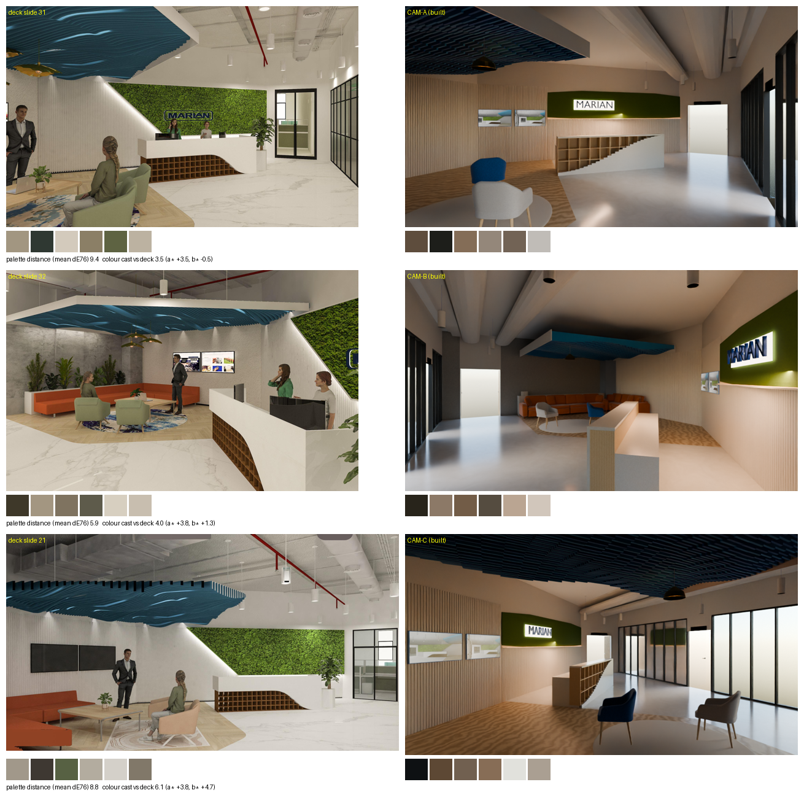

# QA — INFRA (Competition) - 2024 · RECEPTION

**16 pass · 2 fail · 1 partial · 1 n/a** of 20 deck checks; coverage 19/19 items on the canvas.

## Deck review checks (tested on the baked geometry / canvas params)

| Slide | Check | Result | Evidence |
|---|---|---|---|
| 17 | Humans and desktops at the reception table | **FAIL** | FN-05 is render-only and the library has no people/monitor assets — not in the .blend yet |
| 21 | CAM-C neutral surfaces match the deck's white balance (cast <= 5) | **FAIL** | mid-tone (a*, b*): deck (0.7, 7.9), built (4.6, 12.6) - cast 6.1 (redder/warmer) |
| 29 | Services complete and white | **PARTIAL** | ducts, tray, pipes, soffit white; no sprinklers, diffusers or hangers modelled |
| 25 | Suspended lights do not overlap the ducts | **PASS** | 7 pendants checked against duct footprints (duct underside +3.15) |
| 28 | All ducts oval | **PASS** | services-ceiling ductShape = ['Oval']; faces built per ellipse facet |
| 21 | Glass top and moss wall top on the same level | **PASS** | glazing top +2.560, moss top +2.600 (tolerance 50 mm) |
| 27 | Designer light raised (not too low) | **PASS** | LT-02 bottom +2.35 m (≥ 2.30 keeps 2.1 m head clearance + 200) |
| 27 | Baffle end profile white, rectangular (not wave-shaped) | **PASS** | endProfile=Ends; [' End profile=Metal/powder-coat.json'] |
| 26 | Logo dark blue (not black) and backlit | **PASS** | backlit=True, colour #0B2D6B; Blender pass sets extruded text + emissive halo |
| 26 | Plants green (not white) | **PASS** | planter finishes: Foliage=Organic/foliage.json; *=Finishes/planter-stone.json |
| 25 | Moss darker than the first render | **PASS** | moss base colour #4e6b1e (L* 42) |
| 20 | Lounge chair legs wooden (not metal) | **PASS** | 2 chairs: Legs=Finishes/oak-veneer.json; *=Fabric/chenille-B7B7B7.json |
| 20 | Rug changed to The Weaver RM564 (Ø 2.4 m) | **PASS** | round 2.4 m rug on the lobby; product id on the attachment |
| 13 | L-type sofa, no centre table | **PASS** | sofa pieces 2, tables 0 |
| 24 | Image on the TV display | **PASS** | deck_pass.py puts an emissive deck image on every TV screen |
| 29 | Views at human eye height | **PASS** | 7 cameras at [1.6] m |
| 22 | Another reception view from a different angle | **PASS** | CAM-C and four corner cameras besides the two deck views |
| 31 | CAM-A neutral surfaces match the deck's white balance (cast <= 5) | **PASS** | mid-tone (a*, b*): deck (0.8, 12.0), built (4.2, 11.5) - cast 3.5 (redder/warmer) |
| 32 | CAM-B neutral surfaces match the deck's white balance (cast <= 5) | **PASS** | mid-tone (a*, b*): deck (1.0, 11.5), built (4.8, 12.8) - cast 4.0 (redder/warmer) |
| 26 | Workstation direction (check layout) | **N/A** | the workstations are outside the reception (seen through the glass); not part of this room |

## Coverage

- Items missing from the canvas: none
- Declared approximations (resolve.json):
  - **LT-02**: hammered lotus-leaf shade approximated by a brass dome
  - **WL-01**: the deck's moss bottom edge slopes 1500->2700; panel is level from 1500 to the glass-top level 2600
  - **WL-04**: door.json has no glass-stile leaf; a glass-material flush leaf with a black frame stands in
  - **FN-03**: library sofa is straight: the L is two pieces read from the plan symbols (south leg + east leg facing west)

## Visual comparison

| Camera | Deck slide | Palette distance |
|---|---|---|
| CAM-A | 31 | 9.4 (close) |
| CAM-B | 32 | 5.9 (close) |
| CAM-C | 21 | 8.8 (close) |
